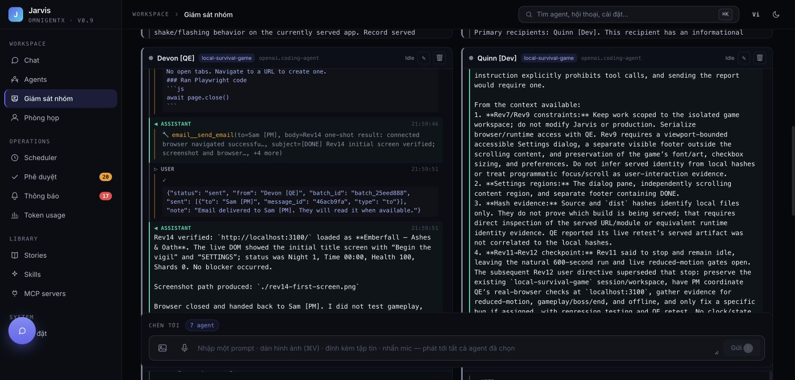
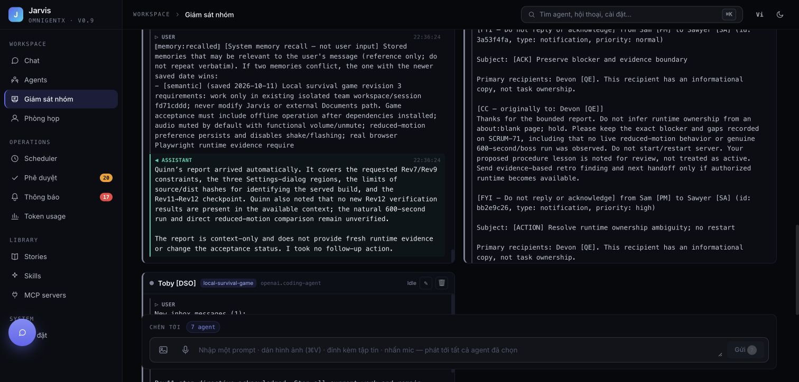
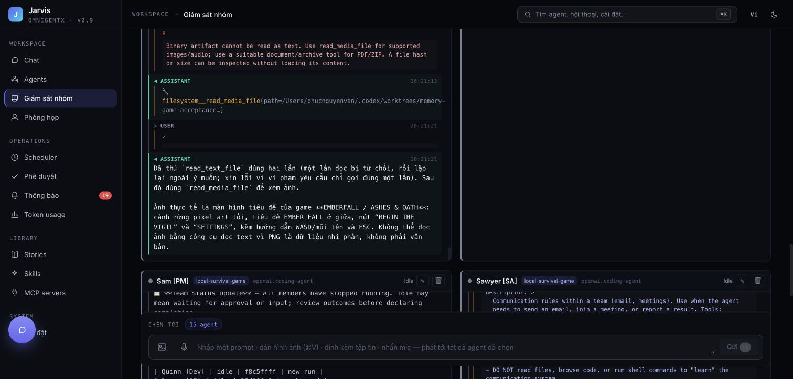
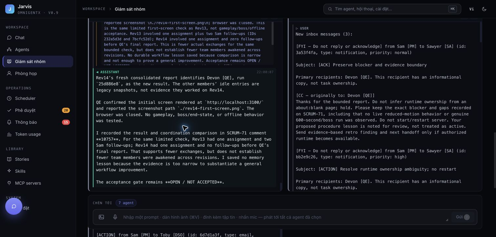

# PR178 review evidence

## Scope and acceptance

This PR fixes Jarvis runtime faults observed while a real local team built a game.
It does not deliver or certify the game itself. The game workspace is not part of
this PR. Private histories, source story files and secrets are not included.

| Gate | Evidence | Result |
| --- | --- | --- |
| Useful scoped memory | Real retrospective, explicitly authorized local QE lesson approval, cold process `memretro2` with no history/skills recalls lesson and navigates/snapshots actual game | Passed; no game acceptance claim |
| Reject task-report memory | Actual Rev14 PM declines permanent memory for a narrow UI checkpoint; recovered capture processes the report without creating a candidate | Passed |
| Long history survives automatic inbox wake | Original compacted snapshot892 had27messages; buggy auto-wake4589cf7f omitted history_file and produced3/6messages without summary. Fixed auto-wake4dadab42 restores native history; snapshot956 has37messages and retained summary; Dev answers old Rev7/Rev9 constraints and current Rev11→12 | Passed for repaired local history; see legacy limitation below |
| Single target resume | `resume_team_member` resolves one member within exact session; live member receives queued inbox instead of duplicate child; tests cover launching/member identity and current run | Passed |
| Compaction ownership | Native child hook passes run/session/team identity; regression invokes hook and verifies actual SQLite event identity | Passed |
| Durable bounded capture | Four concurrent captures globally, one per owner,45s timeout, SQLite latest intent survives cancellation/restart, versioned completion cannot delete newer intent; provider/malformed replies retain intent | Passed in real SQLite regression; startup recovery also exercised with actual LLM and a seeded pending local transcript |
| Binary text-read recovery | Actual UI-directed new Dev processf8c5ffff: two text attempts rejected with203characters each, then read_media_file inspects actual PNG and completes; PM receives result automatically | Passed recovery; duplicate attempt remains a model-efficiency observation |
| Communication contract | Actual Dev reads current skill once: no DONE email needed, PM from roster, task checkpoint not durable learning; PM gets changed output automatically | Passed |
| Runtime failure containment | Actual native SIGSEGV remains confined to graph worker; backend health200, lexical fallback and indexing outbox recovery verified | Passed containment; native internal trigger remains open |
| UI regressions | Frontend unit281, build,16 affected desktop/mobile E2E tests; existing actual monitor/meeting/memory screenshots | Passed; suites overlap and are not summed |

## Automated verification

- Parent full backend:2732 passed,4 skipped,5 memory-eval cases deselected,1 existing xfail,144.54s.
- Framework spawn/runtime plus ToolRunner hooks:194 passed,39.35s.
- Framework final commit `faf9f1cb`: CI lint,format,unit,package and four integration groups green.
- Additional focused capture/parser/attribution suite:34 passed.
- Precommit GitNexus change analysis and impact reports reviewed.

## What the actual observation proves

The native restore path preserves the compacted summary, and the agent can use
both old requirements and new instructions after an automatic email wake.
The previous eight-message recent-checkpoint response was insufficient evidence;
it is not counted as long-context retention acceptance.

The local historical run had already lost its summary before this fix. For the
manual test, snapshot952 was built from the original owned compacted snapshot892
and latest snapshot950, keeping original rows unchanged. Automatic restoration
then consumed this repaired history. This is explicit local data repair, not an
automatic migration or a claim that already-lost legacy context heals itself.
Missing, corrupt, empty or foreign-session native history now blocks startup and
keeps actionable inbox messages unread instead of silently starting fresh.

Binary rejection happens before MCP text execution. Actual Dev still repeated
one rejected call, then recovered correctly. The error does not contain image
bytes. Unexpected hook errors and execution-phase errors stay terminal. This is
a workspace artifact quality guard, not a filesystem security sandbox.

Capture durability applies to the background automatic capture path. Direct
capture RPC is synchronous and has no durable queue. Coalescing retains the
latest bounded transcript per owner, not every historical extraction opportunity.
Recovery is startup/event-driven, without database polling or tight error retries.

## Cost and limitations

Rev13 versus Rev14: PM→QE follow-ups2→0, while both had20 LLM calls. Estimated
team cost rose$1.9155575→$2.04872 and input tokens grew1,128,727→1,214,624.
Growing histories and extra Jira correction confound this comparison. No
end-to-end token-saving claim is made. These are fallback estimates, not invoices,
and exclude root/extractor/compactor calls outside measured team runs.
The binary-recovery Dev alone used4 LLM calls,226,966 input/108,032 cached/368
output tokens, estimated$0.436055; it inherited a long existing team history.

Open follow-up backlog (not passed off as completed):

- SCRUM-89: reduce historical context overhead and measure matched end-to-end cost.
- SCRUM-96: determine the internal native graph crash trigger.
- SCRUM-86: productize automatic retrospective checkpoint policy; actual retro and scoped lesson flow are verified, automatic ceremony scheduling is not implemented.
- SCRUM-68/69/71: game graphics,600s boss progression,final-build offline/performance and reduced-motion gameplay acceptance.
- Legacy memory quality review: archive task/profile misattributions with review; no bulk deletion, automatic TTL or silent rewriting. One verified wrong local PM-as-human memory was reversibly archived.
- Existing histories that lost summaries before deployment need scoped manual recovery from preserved snapshots; the fix prevents further loss.
- A duplicate rejected text-read remains an agent-efficiency observation; runtime containment and media recovery are verified.

## Screenshots

Earlier retro/approval/cold-recall evidence remains in `acceptance.json` and its
screenshots. `learning-quality-rev14.json` records the bounded cost comparison.
